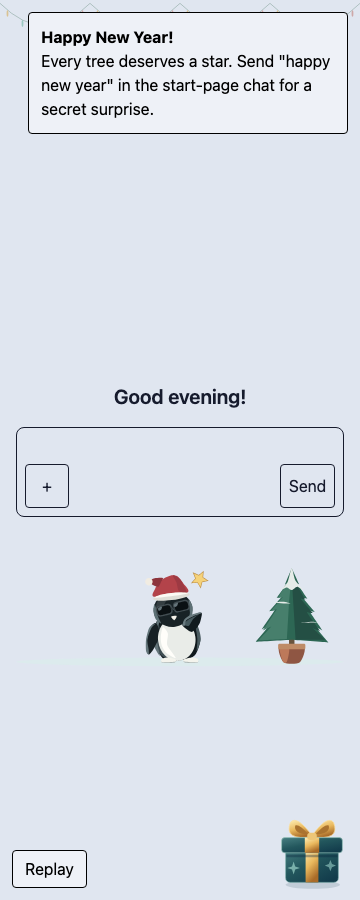
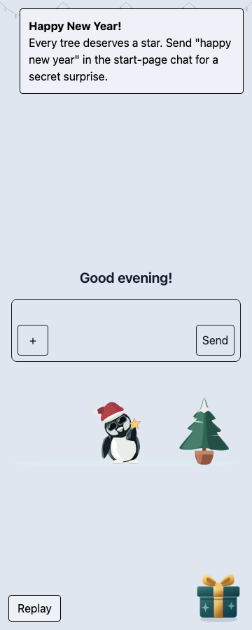
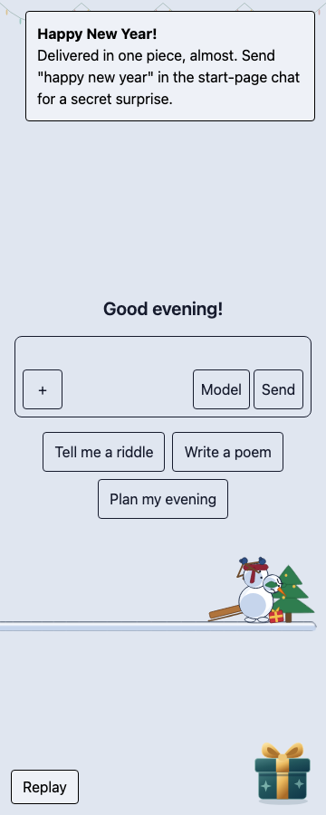
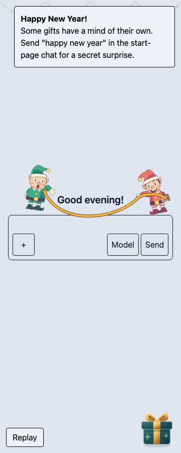
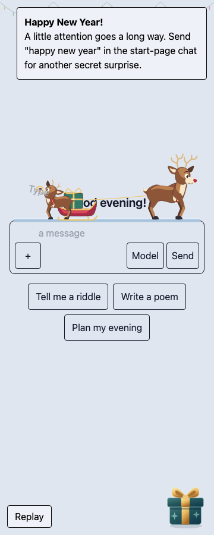

# New Year artwork comparison

Native Chromium screenshots at a 360 × 900 viewport. Before images use the pre-change scene; after images use the final implementation. The images show the Storybook host fixture. They establish the inspected poses, not a continuous visual motion assessment.

| Scene and time | Before | After |
| --- | --- | --- |
| Penguin, 8.5 s |  |  |
| Snowman, 16.5 s |  |  |
| Elves, 6.35 s |  |  |
| Reindeer, 14.65 s |  |  |

See [verification](../verification.md) for contact checks, resource budgets, lifecycle checks, viewport coverage and the unrelated repository-wide test failures.
