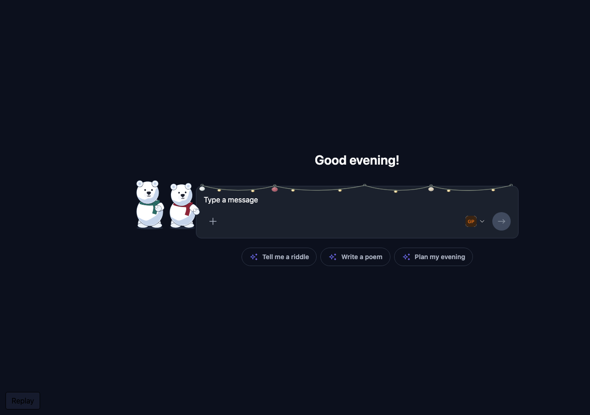

# Archive and PR verification

Archived at the user's explicit request on2026-11-23. The final scope is the reusable Chat composer-carry adapter and a companion Themes package for the independently enabled **New Year Polar Bears** event. Existing New Year defaults remain unchanged.

## Current development integration

The shipping Chat branch is based on development4f38850f2, including the Snowman CopyTrack migration. Composer carry uses the tagged companion preparation contract and preserves CopyTrack dispatch and the single-interaction-capability gate. A measured lower-space guard falls back before copying a bottom-docked composer when the optional side artwork would be clipped. The final native desktop/mobile/poster bytes remain identical to the reviewed local0.1.5 assets.

## Verification

- Carry adapter:40tests passed, including insufficient-space, scaled-boundary and legacy no-side cases.
- Shared keyframe conversion:18tests passed.
- Scene support, CatBorrow, CopyTrack and LottieScene integration:96tests passed.
- Typecheck, changed-TypeScript ESLint and changed-file formatting passed. The isolated worktree uses the documented Nx skipSync option because the base has unrelated TypeScript-reference synchronization changes. Whole-library dependency lint reported an unchanged chat-shared dependency as unused in the symlinked dependency environment; changed-source lint passed. No unrelated manifest/reference changes were included.
- Four complete28second native runs at360/1280pixels and LTR/RTL restored the draft, focus and selection with no browser errors or retained copies/players.
- Documentation validation passed. Spec references reported476specs with zero errors and existing identifier warnings. OpenSpec main-spec validation passed; the active change passed strict validation before archival. Every delta block was compared with its main spec before moving the change.
- Themes publication checker passed without warnings;138tests passed and independent five-axis review approved the package. Existing retained content remains byte-identical.

The original local playback and interruption evidence remains in the preceding evidence files. Checks in this section use the current shipping integration and do not overwrite the historical prototype results.

## Explicit remaining verification limitation

Task4.6 remains unchecked: a continuous assistant artistic assessment of the full scene was not performed. The user explicitly accepted the bears and scene; the assistant inspected native rendered poses and the decoration reveal, and automated playback verified lifecycle behavior. Those are distinct forms of evidence. The change is archived with this limitation recorded, rather than marking an unperformed review complete.

## Review images

These native-player frames show the unchanged final assets in the actual light/dark input palettes:

Local environment files, personal skills, scratch authoring helpers,0.1.x preview catalogs and browser harnesses remain excluded from Git. Creating the two PRs does not merge or deploy them. The requested local ordinary-New-Year setup and deterministic gift-click override are separate ignored preview configuration.
